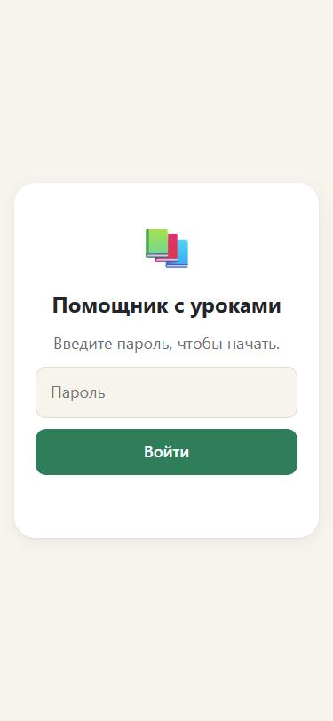
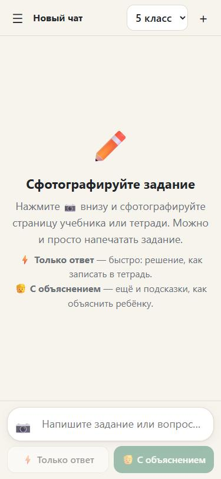
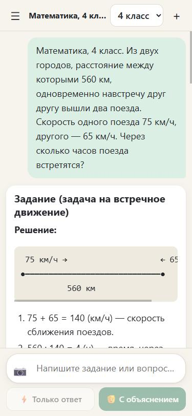
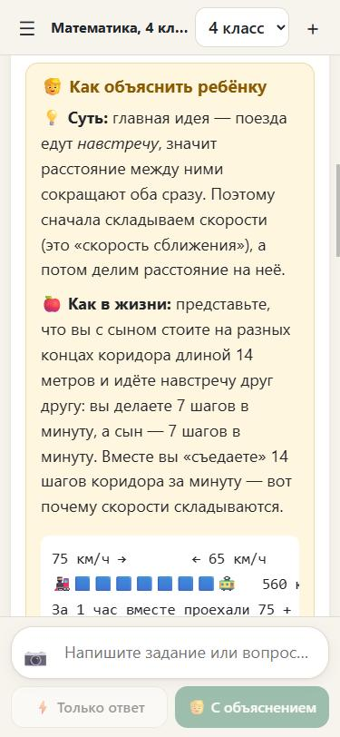
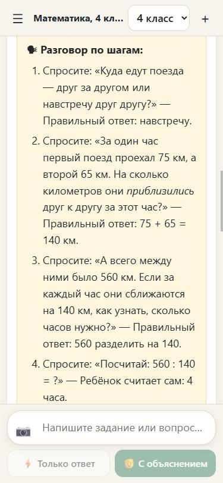
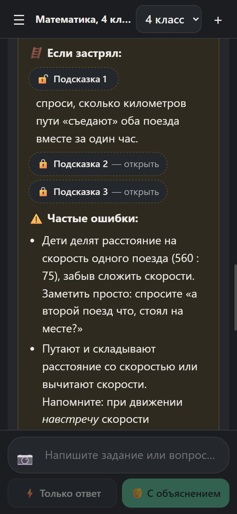
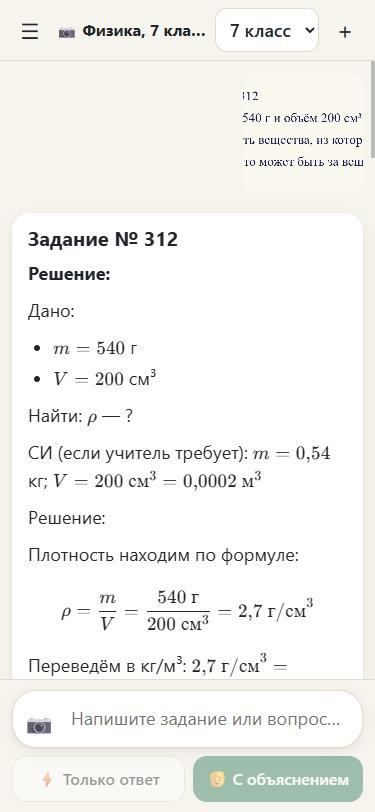
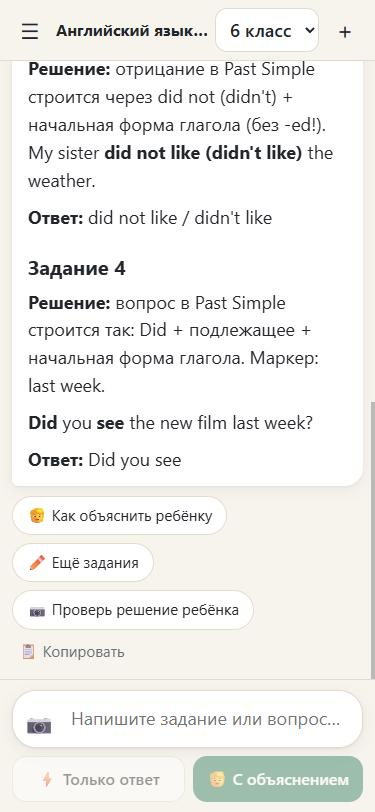
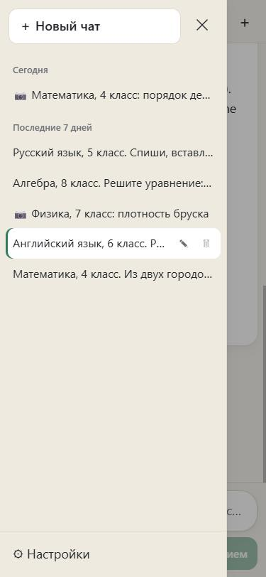
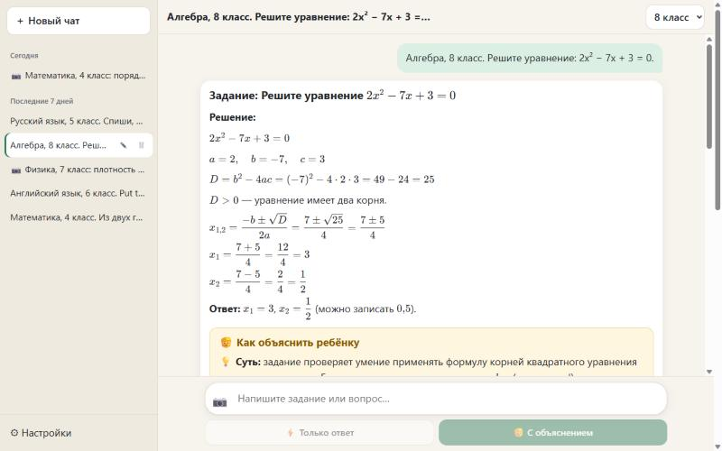

# Помощник с уроками

Простой чат для мамы: фотографирует задание (или печатает текстом) — бот даёт готовое решение
по программе нужного класса (4–9), показывает, как записать в тетрадь, и как объяснить ребёнку.

- Работает с любым OpenAI-совместимым API (сейчас модель `kimi-k3`). Ключ хранится только на сервере.
- Вход по паролю (cookie на год), история чатов как в ChatGPT — общая на всех устройствах.
- Живёт бесплатно в Yandex Cloud и открывается в России без VPN.
- Главное — [системный промпт](#-системный-промпт--главное-в-проекте): бот решает задание и пишет маме сценарий, как объяснить его ребёнку.

## Скриншоты

<table>
  <tr>
    <td align="center"><br>Вход по паролю</td>
    <td align="center"><br>Новый чат: класс и две кнопки</td>
    <td align="center"><br>Решение со схемой</td>
  </tr>
  <tr>
    <td align="center"><br>«Как объяснить ребёнку»</td>
    <td align="center"><br>Разговор по шагам</td>
    <td align="center"><br>Подсказки под спойлером (тёмная тема)</td>
  </tr>
  <tr>
    <td align="center"><br>Задание по фото (физика, 7 кл.)</td>
    <td align="center"><br>⚡ Только ответ и кнопки</td>
    <td align="center"><br>История чатов</td>
  </tr>
</table>



## 🧠 Системный промпт — главное в проекте

Интерфейс здесь простой. Вся «педагогика» живёт в системном промпте —
инструкции, которую модель получает перед каждым разговором:
[`api/_prompt.js`](api/_prompt.js). Полный текст, который уходит модели для 4 класса, —
в [`docs/system-prompt-4-klass.md`](docs/system-prompt-4-klass.md).

### Ключевая идея: бот пишет для мамы, а не для ребёнка

Обычные ИИ-репетиторы (ChatGPT study mode и похожие) разговаривают с учеником и **не дают готовый ответ**.
Здесь пользователь другой — родитель, который сам садится с ребёнком за уроки. Ему нужно две вещи:

1. **Готовое правильное решение**, оформленное как в тетради, — чтобы самому понимать ответ и проверить ребёнка.
2. **Сценарий урока** — как подвести ребёнка к решению, чтобы он додумался сам.

Поэтому промпт отдаёт маме полный ответ, а приём «не говорить ответ, вести вопросами» переносит
в сценарий, по которому мама разговаривает с ребёнком.

### Из чего собран промпт

| Блок | Что делает | Зачем |
|---|---|---|
| **Роль и адресат** | «Опытный учитель и методист» пишет маме на «вы» | Тон взрослому, а не ребёнку |
| **Программа класса** (`GRADE_NOTES`, 4–9) | Решать только тем, что уже проходят: в 4 классе — по действиям и без иксов, в 7–9 — «Дано / Найти / Решение», СИ, формат ОГЭ | Решение «как в школе», а не как в вузе: иначе учитель не примет |
| **Возраст ребёнка** (`EXPLAIN_NOTES`) | 9–10 лет — предметы и картинки из эмодзи 🍎🍎🍎; 12–15 лет — логика «почему так», связь с ОГЭ | Объяснение на понятном возрасту уровне |
| **Методика** | Принципы из таблицы ниже | Ребёнок думает сам, а не списывает |
| **Шаблон ответа** | Жёсткие заголовки и значки: решение → ответ → карточка из 7 разделов | Одинаковый вид на любой модели, страница строит из него интерфейс |
| **Предметы** | Отдельные правила для русского (орфограммы и проверочные слова, разборы), английского (правило по-русски), гуманитарных | Математика — не единственный предмет |
| **Режимы и кнопки** | `[Только ответ]`, «Объясни проще», «Подробнее», «Ещё задания», «Проверь решение ребёнка» | Каждая кнопка — заранее описанная просьба |
| **Оформление** | Формулы в LaTeX, схемы (отрезки, краткая запись) в моноширинном блоке | Дроби и схемы выглядят как в учебнике |
| **Надёжность** | «Перепроверь вычисления», «если фото нечёткое — скажи, что не видно» | Меньше уверенных ошибок |

### Методика: что применено и откуда

| Принцип | Откуда | Где в ответе |
|---|---|---|
| Ребёнок отвечает сам, мама ведёт вопросами | OpenAI **study mode** (вести подсказками, а не давать ответ) | 🗣 «Разговор по шагам»: вопрос — правильный ответ ребёнка |
| Активное обучение | Google **LearnLM**: active learning | Последний шаг разговора ребёнок делает сам |
| Управление нагрузкой | LearnLM: cognitive load — маленькие порции | 3–6 шагов, одна мысль на шаг |
| Подстройка под ученика | LearnLM: adapt to the learner | Таблицы `GRADE_NOTES` / `EXPLAIN_NOTES` по классам |
| Любопытство и связь с жизнью | LearnLM: stimulate curiosity | 🍎 «Как в жизни» |
| Осознание своего мышления | LearnLM: deepen metacognition | ✅ «Как проверить» — обратное действие, прикидка |
| Подсказки по нарастающей | Скаффолдинг: помощь, которую постепенно убирают | 🪜 три подсказки под спойлером: намёк → сильнее → почти ответ |
| От конкретного к абстрактному | Классика методики начальной школы: предмет → картинка → правило | Предметы и эмодзи для младших, правило словами учебника потом |
| Работа с типичными ошибками | Обучение через заблуждения (misconceptions) | ⚠️ «Частые ошибки» и как их заметить |
| Закрепление | Практика припоминания и перенос на новый пример | ✏️ «Похожее задание» с ответом под спойлером |
| Русская школьная методика | Оформление и приёмы российских учебников | Краткая запись, вопросы к действиям, проверочные слова, разборы |

Перед написанием я изучил открытые наборы навыков для ИИ-репетиторов на GitHub
([rohitg00 learn](https://skills.cat/skills/rohitg00/ai-engineering-from-scratch/learn),
[sijiao-skill](https://skills.rest/skill/sijiao-skill-swaylq),
[education-agent-skills](https://gitea.com/miller-one-more/education-agent-skills)).
Готового сценария «объяснить ребёнку через родителя» среди них не нашлось, поэтому шаблон собран с нуля
по принципам выше.

### Промпт как «контракт» с интерфейсом

Модель пишет обычный markdown по жёсткому шаблону, а страница превращает его в интерфейс
(`enhanceAnswer` в [`public/app.js`](public/app.js)):

- заголовок `#### 🧒 Как объяснить ребёнку` и всё под ним — выделенная жёлтая карточка;
- строки, начинающиеся с `🔒` (`🔒 Подсказка 1: …`, `🔒 Ответ: …`), — спойлеры, которые мама открывает по одному;
- формулы между `$…$` рисует KaTeX.

Так не нужен хрупкий JSON-ответ: шаблон держится на любой модели, а если модель чуть отступит
от формата, текст всё равно останется читаемым. Найденная на тестах тонкость: markdown «приклеивал» строку
`**⚠️ Частые ошибки:**` к последней подсказке и прятал её в спойлер — страница теперь начинает каждую
такую подпись с нового абзаца.

Кнопки под ответом не пишут в чат длинных инструкций: в переписке видна короткая подпись
(«🧒 Объясни проще»), а модели уходит заранее описанная просьба (`ACTIONS` в `public/app.js`),
которую промпт тоже знает по имени.

### Настройка модели

- **Модель — `kimi-k3`**: понимает фото и хорошо держит шаблон. При выборе проверялось служебное поле
  `model` в потоке ответа: у прокси модели с названиями `claude-*` на деле оказались `glm-5.3-prime`
  без поддержки фото. Названиям моделей у посредников верить нельзя.
- **`reasoning_effort: low`**. `kimi-k3` — «рассуждающая» модель. Журнал этапов запроса показал,
  что на задании по русскому она 100+ секунд выдавала только скрытые рассуждения (~400 КБ) и ни символа ответа;
  ответ занимал 137 секунд, а иногда не укладывался и в 5 минут. С `low` то же задание — **31 секунда**.
- **Промпт хранится на сервере** и не приходит из браузера: подменить его нельзя, класс проверяется (4–9).

### Как проверяли

1. **Формат** — на поддельной модели [`scripts/mock-upstream.mjs`](scripts/mock-upstream.mjs),
   которая отвечает строго по шаблону: карточка, спойлеры, формулы, кнопки.
2. **Качество** — на настоящей модели, 5 заданий разных классов и предметов:

| Класс | Предмет | Задание | Ответ модели | Верно |
|---|---|---|---|---|
| 4 | Математика | Поезда навстречу: 560 км, 75 и 65 км/ч | 4 часа | ✅ |
| 5 | Русский язык | Р..сли, с..сны, з..мечали, пт..цы, л..тят, б..рёзой, выр..с | все 7 букв | ✅* |
| 6 | Английский | Past Simple: go, play, not like, you see | went, played, didn't like, Did you see | ✅ |
| 7 | Физика (по фото) | Плотность бруска 540 г, 200 см³ | 2,7 г/см³, алюминий | ✅ |
| 8 | Алгебра | 2x² − 7x + 3 = 0 | x₁ = 3, x₂ = ½ | ✅ |

\* Буквы верные, но для «сосны» модель предложила проверочное слово «со́сна» (на деле сосна́).
Модель может ошибаться в мелочах — объяснение стоит пробегать глазами.

### Как поменять поведение бота

1. Отредактировать [`api/_prompt.js`](api/_prompt.js) (общий текст, `GRADE_NOTES`, `EXPLAIN_NOTES`).
2. Пересобрать пример: `node scripts/print-prompt.mjs 4 > docs/system-prompt-4-klass.md`.
3. Проверить на поддельной модели (`npm run mock` + `npm start`), затем выложить: `node scripts/deploy-yandex.mjs`.

Источники: [Google LearnLM](https://blog.google/products-and-platforms/products/education/google-learnlm-gemini-generative-ai/),
[разбор технического отчёта LearnLM](https://garyliang.substack.com/p/google-learnlm-technical-paper),
[OpenAI study mode (Simon Willison)](https://simonwillison.net/2025/Jul/29/openai-introducing-study-mode).

## Как устроено

```
public/          страница чата (HTML/CSS/JS, без сборки); vendor/ — marked, DOMPurify, KaTeX
yandex/          обёртка для Yandex Cloud Functions (HTTP-событие -> обработчики из api/)
scripts/         развёртывание в Yandex Cloud, смена ключа/пароля, печать промпта, поддельный API для проверки
docs/            скриншоты и полный текст системного промпта
server.mjs       обычный Node-сервер (локальный запуск, Amvera): отдаёт public/ и вызывает api/
amvera.yaml      настройки запуска на Amvera (запасной вариант)
api/chat.js      проверяет пароль, добавляет ключ и подсказку для модели, пересылает запрос в API
api/models.js    список моделей для выбора в ⚙ Настройках
api/login.js     вход (ставит cookie) и выход
api/chats.js     история чатов: список, открыть, сохранить, переименовать, удалить
api/images.js    загрузка и выдача фото заданий
api/_store*.js   история и фото: файлы в бакете (Yandex), SQLite (Node-сервер) или Upstash Redis (Vercel)
api/_prompt.js   системная подсказка (как бот отвечает) — здесь можно менять стиль ответов
```

## Настройки (переменные окружения)

| Переменная        | Что это                                                    |
|-------------------|------------------------------------------------------------|
| `OPENAI_API_KEY`  | твой API-ключ                                              |
| `OPENAI_BASE_URL` | адрес OpenAI-совместимого API, например `https://api.openai.com/v1` |
| `OPENAI_MODEL`    | модель по умолчанию (должна понимать картинки)             |
| `SITE_PASSWORD`   | пароль, который мама вводит при входе (смена — выход на всех устройствах) |
| `REASONING_EFFORT` | `low` — просит «рассуждающую» модель думать меньше (иначе задания по русскому идут минутами) |
| `STORE`, `DATA_DIR` | где хранить историю (`fs` + папка; в Yandex Cloud — смонтированный бакет) |
| `KV_REST_API_URL`, `KV_REST_API_TOKEN` | Upstash Redis (только для варианта на Vercel) |

## Хостинг: Yandex Cloud (бесплатно, работает в России без VPN)

IP-адреса Vercel в России заблокированы, поэтому сайт живёт в Yandex Cloud в пределах
бесплатного уровня serverless (Cloud Functions, Object Storage, API Gateway):

- страница (`public/`) — бакет `domashka-site-…`, отдаётся через API Gateway;
- `/api/*` — облачная функция `domashka-api` (Node.js 22, обёртка `yandex/`), ответ модели приходит целиком;
- история и фото — файлами в бакете `domashka-data-…`, смонтированном в функцию (`STORE=fs`).

Обновить сайт после изменений (нужна утилита `yc` после `yc init`):
```bash
node scripts/deploy-yandex.mjs
```
Задать или сменить адрес API, API-ключ и пароль сайта (спросит в терминале, ключ и пароль — скрытым вводом):
```bash
node scripts/set-secrets-yandex.mjs
```

Запасные варианты в коде: `server.mjs` + `amvera.yaml` (обычный Node-сервер, история в SQLite)
и `vercel.json` (Vercel + Upstash Redis).

## Локальный запуск

Нужен Node.js 22.13+.

```bash
cp .env.example .env.local   # и заполнить значения
npm start                    # http://localhost:3000, база в ./data
```

Проверка без настоящего ключа — поддельный API (в одном терминале `npm run mock`, в `.env.local`
поставить `OPENAI_BASE_URL=http://localhost:4010/v1`, `OPENAI_API_KEY=test-key`, `OPENAI_MODEL=mock-vision`,
`KV_REST_API_URL=http://localhost:4010/redis`, `KV_REST_API_TOKEN=test-redis`).

## Ограничения

- Фото сжимаются в браузере до 1600 px (~150–300 КБ), до 6 фото за раз. Модели отправляются
  последние 12 фото переписки — для нового задания лучше начать «Новый чат».
- Бесплатный уровень Yandex Cloud: 1 млн вызовов функции, 10 ГБ×час, 1 ГБ в Object Storage (тысячи фото),
  100 тыс. запросов к API Gateway в месяц. Удаление чата удаляет и его фото.
- Ответ модели приходит целиком (без постепенной печати): ⚡ ~8 с, 🧒 ~30–50 с; крайний срок — 4 минуты.
